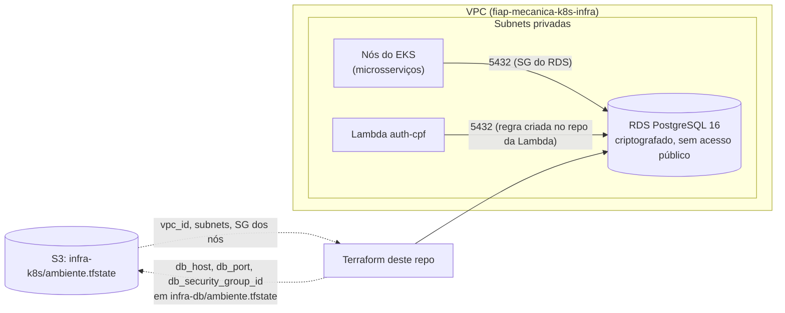

# fiap-mecanica-infra-dbs

Infraestrutura do banco de dados gerenciado da Oficina Mecânica (Tech Challenge, Fase 3): **Amazon RDS for PostgreSQL**
provisionado com Terraform. É o **repositório 3 de 4**.

| Repositório | Papel |
|---|---|
| [fiap-mecanica-k8s-infra](https://github.com/FIAP-Mechanics/fiap-mecanica-k8s-infra) | VPC, EKS, dashboards e alertas |
| **fiap-mecanica-infra-dbs** (este) | RDS PostgreSQL gerenciado |
| [fiap-mecanica-lambda](https://github.com/FIAP-Mechanics/fiap-mecanica-lambda) | Function serverless de autenticação por CPF |
| [fiap-mecanica](https://github.com/FIAP-Mechanics/fiap-mecanica) | Microsserviços, API Gateway (Kong) e manifests Kubernetes |

## O que este repositório provisiona

Uma instância RDS PostgreSQL por ambiente (`homologacao` e `producao`), nas subnets **privadas** da VPC criada em
`fiap-mecanica-k8s-infra` (lida pelo state remoto), com `storage_encrypted`, sem acesso público e com um security group que só aceita
a porta 5432 vindo dos nós do EKS. A regra de entrada da Lambda é criada no repositório dela, a partir do output
`db_security_group_id`.

Os bancos lógicos de cada microsserviço, os usuários e a view `v_cliente_autenticacao` **não** são criados aqui: como o RDS é privado,
Jobs no cluster (`rds-bootstrap` e `auth-cpf-db-init`) os criam no deploy do repositório da aplicação. O schema vem do Hibernate de cada serviço.

Outputs consumidos pelos outros repositórios: `db_host`, `db_port`, `db_security_group_id`.

## Tecnologias

Terraform (>= 1.10, provider `aws ~> 5.80`), Amazon RDS for PostgreSQL 16, S3 para state (`use_lockfile`), GitHub Actions.

## Diagrama da arquitetura



## Como executar

Pré-requisitos: Terraform >= 1.10, credenciais AWS do Learner Lab e o ambiente de `fiap-mecanica-k8s-infra` já aplicado.

```bash
terraform init \
  -backend-config="bucket=<bucket>" -backend-config="key=infra-db/homologacao.tfstate" \
  -backend-config="region=us-east-1" -backend-config="use_lockfile=true"
terraform apply -var-file=envs/homologacao.tfvars \
  -var="state_bucket=<bucket>" -var="master_password=<senha>"
```

Validação sem credenciais: `terraform fmt -check && terraform init -backend=false && terraform validate`.

## CI/CD e deploy

- `ci.yml`: em pull request para `main` ou `homologacao`, roda `fmt -check`, `init -backend=false` e `validate`.
- `deploy.yml`: push em `homologacao` aplica a **homologação**; push em `main` aplica **produção** (Environment `producao` com aprovação).
- Secrets do Environment: `AWS_ACCESS_KEY_ID`, `AWS_SECRET_ACCESS_KEY`, `AWS_SESSION_TOKEN` (renovados a cada sessão do lab) e
  `DATABASE_PASSWORD`. Variables: `TF_STATE_BUCKET`, `AWS_REGION`. O script `aws-lab-secrets.sh` do `fiap-mecanica-k8s-infra`
  configura tudo.

### Configurar os Environments do GitHub

Os Environments `homologacao` e `producao` deste repositório são independentes dos Environments da aplicação. Antes de
executar [Deploy](.github/workflows/deploy.yml), confira em **Settings > Environments > ambiente**:

- **Secrets obrigatórios:** `AWS_ACCESS_KEY_ID`, `AWS_SECRET_ACCESS_KEY`, `AWS_SESSION_TOKEN` e `DATABASE_PASSWORD`.
- **Variable obrigatória:** `TF_STATE_BUCKET`, com o mesmo bucket dos demais repositórios. `AWS_REGION` é opcional e usa
  `us-east-1` por padrão.

`DATABASE_PASSWORD` deve ter o mesmo valor neste repositório e em `fiap-mecanica` para o **mesmo** ambiente. Em produção
existente, preserve a senha atual: trocar apenas o secret do GitHub não altera de forma coordenada os consumidores do banco.
Atualize as três credenciais AWS temporárias a cada sessão do Learner Lab. Execute este workflow depois do deploy de
Kubernetes e antes do de Lambda, selecionando `homologacao` ou `main` em **Actions > Deploy > Run workflow**.

O [guia de deploy dos quatro repositórios](https://github.com/FIAP-Mechanics/fiap-mecanica/blob/main/DEPLOY.md) reúne a
tabela de secrets, a sequência completa e os erros já encontrados.

Regras do repositório: `main` e `homologacao` protegidas (sem commit direto, pull request, aprovação e checks de CI
obrigatórios). O convite de colaboração de `soat-architecture` precisa ser aceito antes da entrega.

### Ordem de provisionamento

fiap-mecanica-k8s-infra → **fiap-mecanica-infra-dbs** → fiap-mecanica-lambda → fiap-mecanica. Destruição na ordem inversa
(`aws-lab-down.sh` do `fiap-mecanica-k8s-infra`). Este repositório depende do state `infra-k8s/<ambiente>.tfstate`.

Limitações aceitas no laboratório: sem Multi-AZ, `skip_final_snapshot` ligado e retenção de backup de 1 dia só em produção.

## Dockerfile

Não aplicável: este repositório contém apenas Terraform, sem imagem própria.

## Swagger/Postman das APIs

Este repositório não expõe API. As APIs ficam no repositório da aplicação:
[collection Postman](https://github.com/FIAP-Mechanics/fiap-mecanica/blob/main/postman/mecanica-completa.postman_collection.json)
e Swagger de cada serviço em `/swagger-ui.html`.

## Deploys ativos

| Ambiente | Instância RDS | Endpoint |
|---|---|---|
| Homologação | `mecanica-homologacao` | privado (output `db_host`) |
| Produção | `mecanica-producao` | privado (output `db_host`) |
